# SupportPilot 业务流程说明与流程图

> 基线：2026-11-18，以当前代码为准（Spring Boot 3.3 + MySQL + Milvus + React 18）。
> 本文按「业务主线 → 关键子流程 → 数据模型 → 代码索引」组织，图中的每个环节都能在文末代码索引里找到落点。
> 图中 `Mermaid` 语法在 GitHub / GitLab / VS Code / Trae 的 Markdown 预览中可直接渲染。

---

## 0. 一页看懂

SupportPilot 是面向企业技术支持团队的工单系统。核心闭环只有一句话：

> **工单从多渠道进来 → 分诊/接单 → AI 结合知识库生成回复草稿 → 人工审阅采纳 → 回复客户并解决 → 已解决工单反哺知识库 → 数据进看板。**

分工上：

| 角色 | 主要动作 |
| --- | --- |
| 客户（外部） | 提工单、补充信息、被回复、被评价（客户门户 V2.2，本轮由工程师代录 CSAT） |
| 工程师 ENGINEER | 接单、处理、写会话/内部备注、使用 AI 草稿、转派/升级 |
| 主管 MANAGER | 客户与联系人维护、存量工单归户、查看全部工单 |
| 管理员 ADMIN | 用户/工作组/通知规则/操作日志/邮件任务，全部数据 |
| 知识库管理员 KB_ADMIN | 知识库文档上传、重建索引、删除、同步已解决工单 |

一条工单的完整生命周期：

1. **进入**：手工建单 / 批量导入 / GitHub Issue 定时同步。
2. **落状态**：新工单统一为「待分诊」，同时启动 SLA 倒计时。
3. **处理**：工程师「接单」→「处理中」，记录首次响应时间；可转派（触发通知）、升级 L2。
4. **求助 AI**：`AI Copilot` 通过 RAG 检索知识库 + 调大模型，SSE 流式返回思考过程、引用和草稿。
5. **采纳**：人工可编辑草稿，确认后写一条对客户可见的回复、置「已解决」、记录解决时间。
6. **沉淀**：已解决工单异步写入 Milvus 向量库，成为后续 AI 的检索依据。
7. **度量**：SLA 达成率、FRT、MTTR、CSAT、AI 成本、知识库命中率等进入看板。

---

## 1. 系统总览

### 1.1 架构与模块

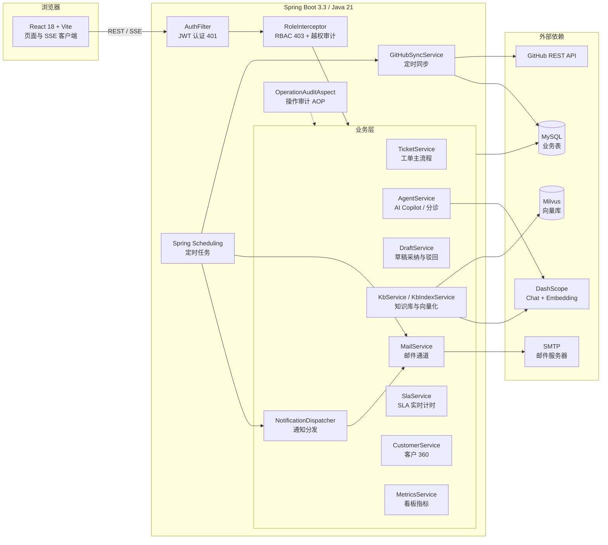

要点：

- 前后端分离，统一返回体 `{ code, message, data }`，`code != 0` 为失败。
- `AuthFilter` 负责「有没有登录」（401），`RoleInterceptor` 负责「能不能做」（403），两层职责分离。
- AI 默认走真实大模型 + 真实向量检索；只有在调用失败（无 Key / 网络异常）时才回退到内置演示时间线，保证页面永远有反馈。
- 所有外部依赖（SMTP、Milvus、GitHub）都做了降级：失败不阻断工单主流程。

### 1.2 页面与功能地图

| 路由 | 页面 | 主要能力 |
| --- | --- | --- |
| `/login` `/register` | 登录 / 注册 | 签发 JWT（含 role / teamId / dataScope） |
| `/` | 工单列表 | 多维筛选、仅看超时、仅看未归户、批量导入、批量归户、导出 CSV、新建工单 |
| `/tickets/:id` | 工单详情 | 接单、转派、改优先级、升级、改状态、会话/内部备注、AI Copilot、AI 分诊、关联工单、CSAT、快捷回复模板 |
| `/customers` `/customers/:id` | 客户列表 / 客户 360 | 客户 CRUD、停用、联系人维护、合同、工单分页、近 5 单、平均 CSAT |
| `/board` | 效果看板 | KPI、趋势、运营指标、草稿反馈、时间范围切换、CSV 导出 |
| `/kb` | 知识库 | 文档上传、删除、单篇/全量重建索引、同步已解决工单、产品线筛选、检索 |
| `/users` `/profile` | 用户管理 / 个人设置 | ADMIN 管理角色/工作组/数据范围；本人改显示名与密码 |
| `/notifications` `/notify-rules` | 通知中心 / 通知规则 | 未读数、已读、类型筛选；ADMIN 配置规则与失败邮件重发 |
| `/logs` | 操作日志 | ADMIN 查看操作审计（含前后快照） |

### 1.3 鉴权与权限链路

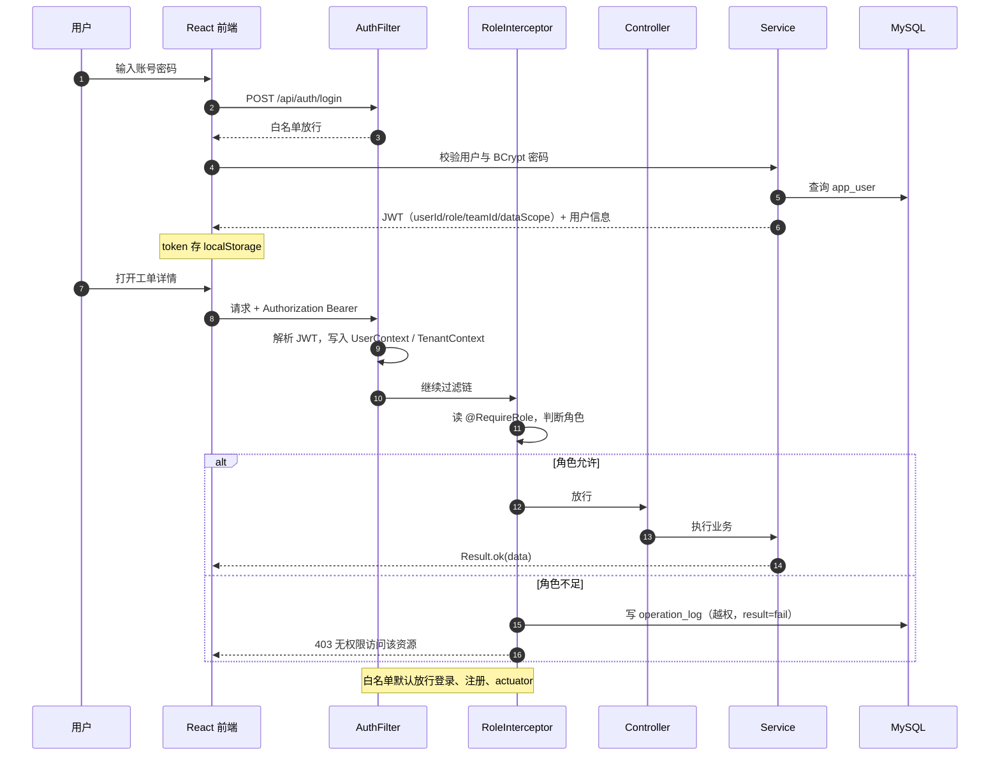

**角色矩阵（写操作）**

| 能力 | ADMIN | MANAGER | ENGINEER | KB_ADMIN |
| --- | --- | --- | --- | --- |
| 用户增删改 / 工作组 | ✅ | ❌ | ❌ | ❌ |
| 操作日志 / 通知规则 / 邮件任务 | ✅ | ❌ | ❌ | ❌ |
| 客户 / 联系人写操作 | ✅ | ✅ | ❌ | ❌ |
| 存量工单归户 | ✅ | ✅ | ❌ | ❌ |
| 知识库上传 / 删除 / 重建 / 同步 | ✅ | ❌ | ❌ | ✅ |
| 工单接单 / 转派 / 改状态 / 草稿采纳 | ✅ | ✅ | ✅ | ✅（按数据范围） |
| 个人设置 `/api/users/me` | ✅ | ✅ | ✅ | ✅ |

**数据范围**

- `SELF`：只看分配给本人的工单。
- `TEAM`：本人 + 同工作组（`user.team_id` 相同）成员的工单。
- `ALL`：全部。
- 默认：ADMIN / MANAGER → `ALL`，ENGINEER / KB_ADMIN → `TEAM`；ADMIN 可对个别成员调整。
- 列表在 SQL 层拼谓词过滤，详情在 `get()` 里做二次校验，越范围直接 403。
- 演示模式（无 JWT、`tenant_id = null`）或 `RBAC_ENABLED=false` 时放宽为 `ALL`，方便本地演示与回滚。

---

## 2. 工单从哪里来

### 2.1 三种入口

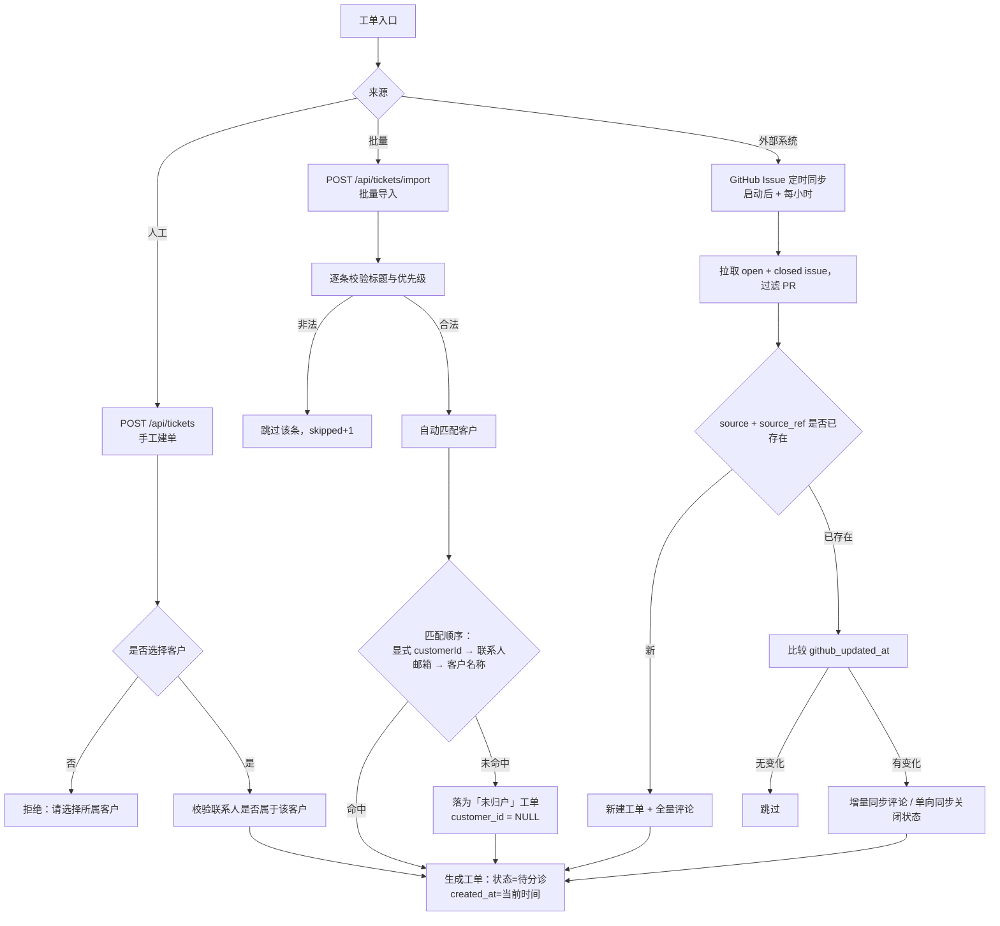

### 2.2 手工建单

- 必填：标题、客户；联系人可选，但选择时必须属于该客户。
- 可选：描述、优先级（P1–P4，默认 P3）、分类（默认「未分类」）、产品。
- 新工单固定 `待分诊`，`created_at` 即 SLA 计时起点。
- 工单号即数据库自增主键，对外展示为 `#123` 形式（`TicketVO.id`）；前端调用时再解析掉 `#`。

### 2.3 批量导入与存量归户

- 导入是「尽力而为」：单条非法只跳过，不会整批回滚。
- 客户匹配顺序：请求里的 `customerId` → 联系人邮箱 → 客户名称；都没命中则落「未归户」。
- 列表可筛「仅看未归户」，勾选后批量归户（ADMIN / MANAGER）；只更新 `customer_id IS NULL` 的工单，已挂客户的计入 `skipped`，避免误覆盖。

### 2.4 GitHub Issue 同步

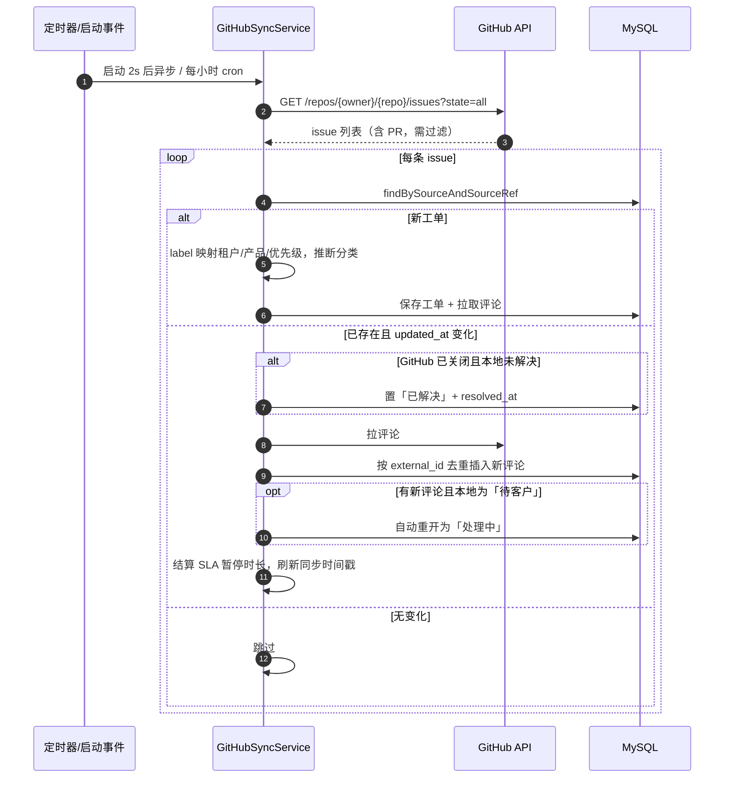

设计取舍：

- **不回退已解决**：GitHub 重新打开 issue 不会把本地「已解决」改回去，避免覆盖人工采纳结果。
- **不覆盖人工修改**：标题、正文、优先级、租户、产品只在首次入库时写入。
- **幂等**：`source + source_ref` 唯一，评论按 `external_id` 去重。

---

## 3. 工单处理主流程

### 3.1 状态机

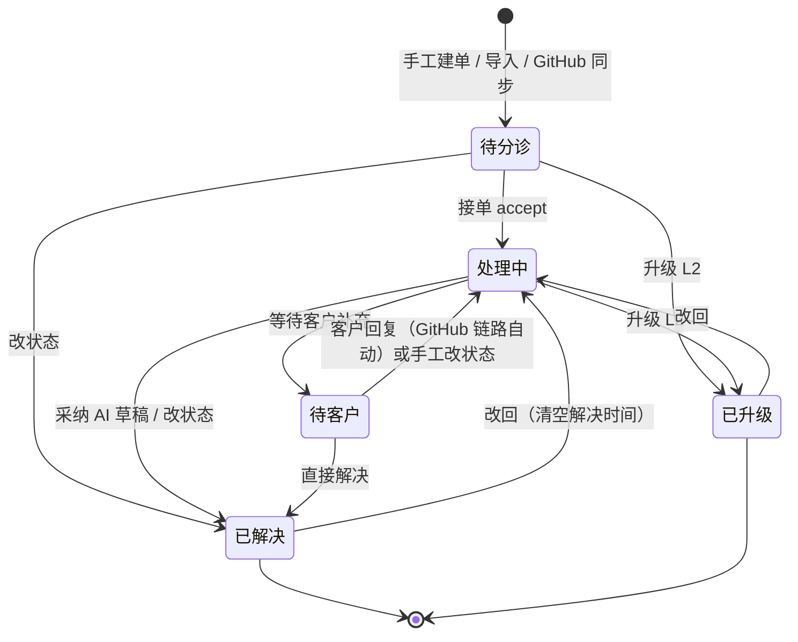

状态只有 5 个：`待分诊 / 处理中 / 待客户 / 已解决 / 已升级`，后端对非法状态直接拒绝。

每个状态变化会牵动：

| 变化 | 副作用 |
| --- | --- |
| 首次接单 | 写入 `first_response_at`（FRT 指标） |
| 进入「待客户」 | 记录 SLA 暂停起点，计时冻结 |
| 离开「待客户」 | 累计暂停秒数，恢复计时 |
| 进入「已解决」 | 写入 `resolved_at`，停止计时，异步沉淀知识库 |
| 离开「已解决」 | 清空 `resolved_at` |
| 进入「已升级」 | 停止计时 |

### 3.2 接单 / 转派 / 升级

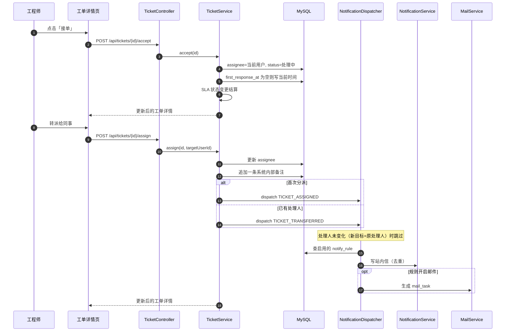

- 「升级 L2」只是把状态置为「已升级」，不创建新工单；SLA 随之停止。
- 转派通知是独立事务（`REQUIRES_NEW`），通知失败绝不影响转派本身。

### 3.3 会话消息与内部备注

- `POST /api/tickets/{id}/messages`，请求体 `{ text, internal }`。
- `internal = false`：对客户可见的回复，出现在客户可见会话中。
- `internal = true`：内部备注，仅团队可见，也不会被写入知识库。
- 转派等系统动作会自动追加 `who=系统` 的内部备注，便于追溯。
- 注意：目前「客户回复自动重开」只在 GitHub 同步链路实现；手工新增的客户消息不会自动把「待客户」改回「处理中」，需要人工改状态（已知限制）。

### 3.4 SLA 计时

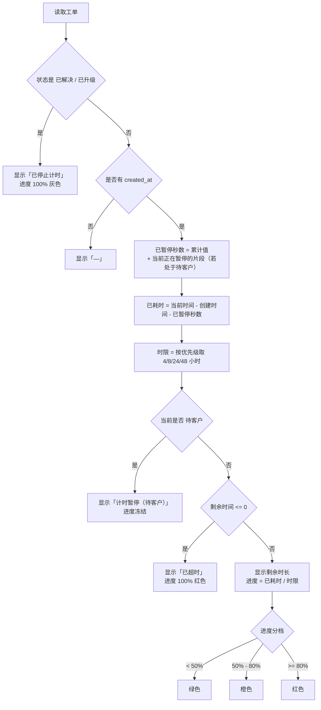

配置（环境变量可覆盖）：

| 优先级 | 默认时限 | 环境变量 |
| --- | --- | --- |
| P1 | 4 小时 | `SLA_P1_HOURS` |
| P2 | 8 小时 | `SLA_P2_HOURS` |
| P3 | 24 小时 | `SLA_P3_HOURS` |
| P4 | 48 小时 | `SLA_P4_HOURS` |

- SLA 不落库（除暂停字段外），每次组装 VO 时实时计算，保证列表与详情看到的都是最新倒计时。
- 「仅看超时」的 SQL 谓词按「创建时间 + 优先级时限」粗判，未扣历史暂停秒数，极少数长暂停工单可能边界误判（展示层仍精确）。

---

## 4. AI Copilot

### 4.1 流式生成回复草稿

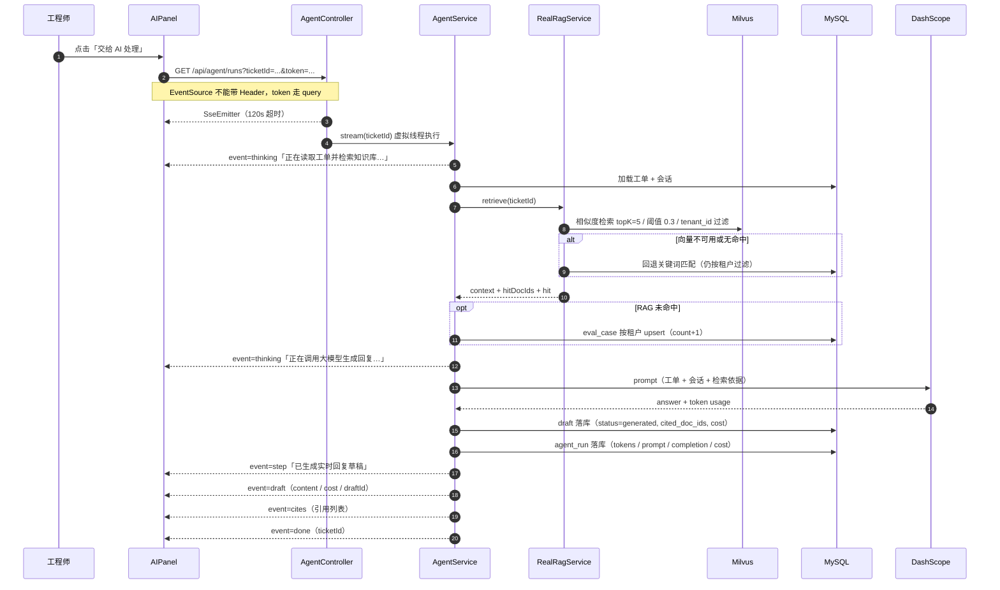

异常与兜底：

- 未配置 Key、模型报错、超时：`tryRealStream` 返回 false，自动回退 `runDemoScenario`（与原型一致的时间线），页面不会空白。
- 草稿落库失败只记日志，不阻断 SSE。
- 同一工单多次生成时，只更新「最近一条未被采纳」的草稿，不覆盖已采纳的历史。

### 4.2 采纳 / 驳回闭环

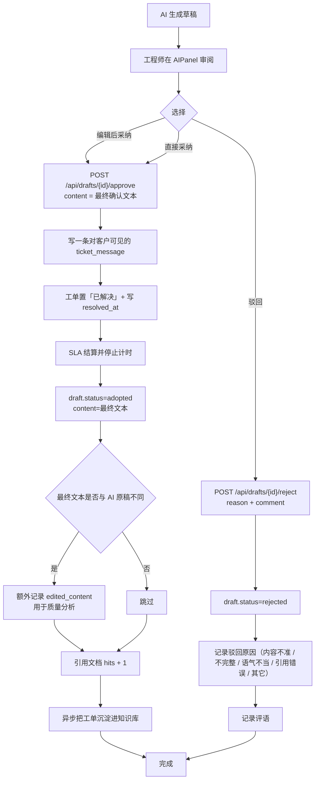

- 「采纳即回复」：不会出现「状态已解决但会话里没有回复」的数据断裂。
- 采纳时若人工改过内容，原稿与终稿都会留痕，用于后续 diff 与反馈统计。
- 看板提供 `GET /api/drafts/feedback-stats`：采纳数、驳回数、被编辑数、驳回原因分布。

### 4.3 AI 分诊建议

`GET /api/agent/triage?ticketId=...`，返回建议优先级、分类、处理人和理由：

1. 有可用大模型：要求模型输出严格 JSON（priority / category / reasoning），解析时容错截取首个 `{` 到末个 `}`。
2. 调用失败：回退规则，默认 P3，分类沿用工单现有值，理由标注「已按规则回退」。
3. 处理人：统计每个人未结工单数（排除已解决 / 已升级），取负载最低者，并列取 id 最小。
4. 前端详情页三个「应用」按钮分别调用改优先级 / 改分类 / 转派端点。

---

## 5. 知识库与 RAG

### 5.1 入库

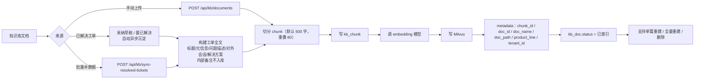

- 工单沉淀用 `path = ticket/#{id}` 幂等去重，重复同步不会产生多份。
- 租户隔离：向量 metadata 带 `tenant_id`，检索时既下推 `filterExpression`，也在 Java 层再兜底过滤一次。
- 旧向量若没有 `tenant_id`，需要在知识库页执行一次「重建索引」补 metadata，否则保守地检索不到。

### 5.2 检索与生成

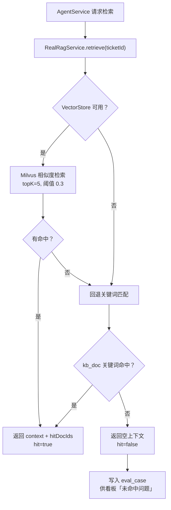

无检索依据时，Prompt 会明确要求模型「基于工单与专业知识直接回复，不要以缺少资料为由拒答」，避免答非所问。

---

## 6. 通知中心

### 6.1 事件 → 规则 → 站内信 / 邮件

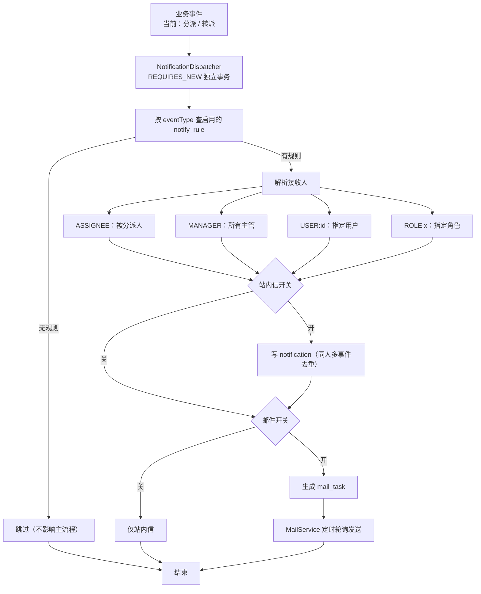

默认内置 4 条规则（启动时幂等补齐，修改即时生效）：

| 事件 | 接收人 | 站内信 | 邮件 |
| --- | --- | --- | --- |
| 工单分派 | 被分派人 | 开 | 关 |
| 工单转派 | 被分派人 | 开 | 关 |
| SLA 预警 | 处理人 + 主管 | 开 | 关 |
| SLA 超时 | 处理人 + 主管 | 开 | 关 |

> SLA 预警 / 超时、审批待办 / 结果的事件类型与规则已就绪，但定时扫描与审批流属于 V2.1，本轮暂无触发源。

通知消费：

- 顶栏铃铛显示未读数，30 秒轮询，同时监听前端 `sp:notify` 事件即时刷新。
- 通知中心支持按类型筛选、点击标记已读并跳转工单、全部已读。
- 站内信保留 90 天，每日 03:00 定时清理。

### 6.2 邮件通道与重试

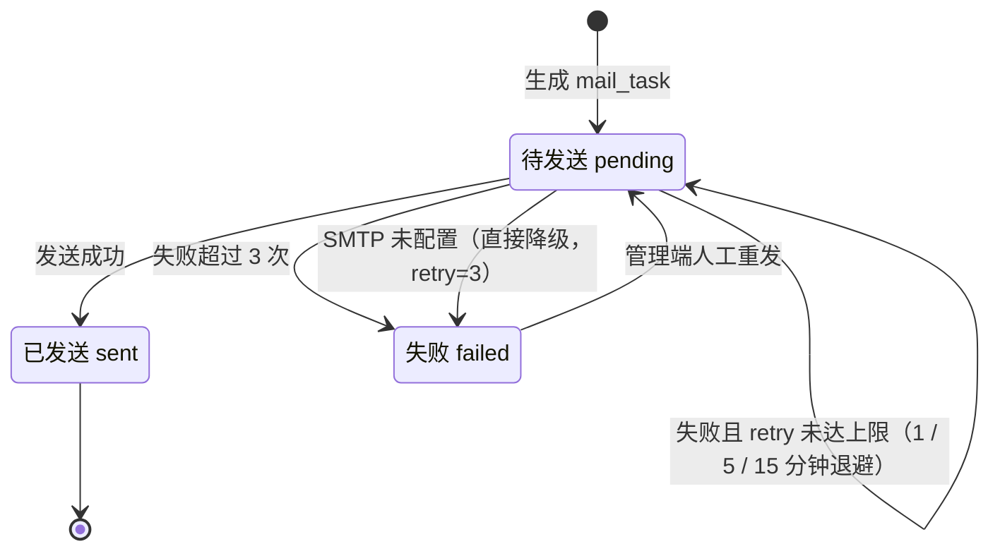

- 收件人按 `登录名@MAIL_DOMAIN` 推导（当前无 `app_user.email` 字段）。
- SMTP 未配置时：邮件任务入库即失败，原因写明「SMTP 未配置，邮件已降级为仅站内信」，站内信照常产生。
- 凭据只通过环境变量注入，不入库、不进日志。
- 发送间隔 20 秒轮询，异步执行，不阻塞业务接口。

---

## 7. 客户域

### 7.1 业务规则

| 规则 | 说明 |
| --- | --- |
| 客户编码唯一 | 租户内唯一，重复直接报「客户编码已存在」 |
| 服务等级 | 金牌 / 银牌 / 铜牌 / 默认 |
| 客户删除 | 已关联工单的客户禁止物理删除，只能停用 |
| 联系人邮箱唯一 | 同一客户内唯一 |
| 主联系人 | 每个客户有且仅有一个，设置新主联系人时自动取消旧主 |
| 工单挂客户 | 手工建单必须选客户；联系人必须属于所选客户 |
| PII 保护 | 客户详情页联系人邮箱 / 手机号脱敏展示，编辑时用原值 |

### 7.2 客户 360

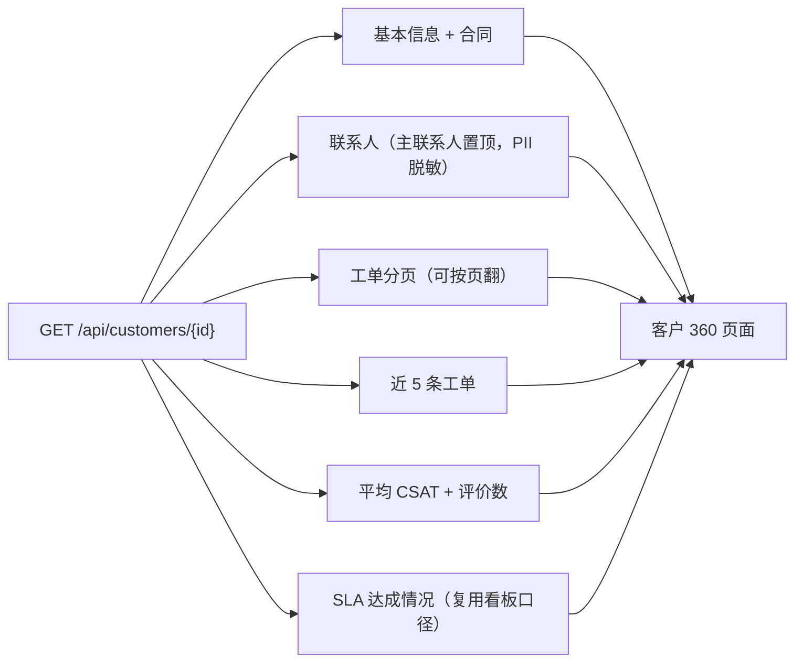

---

## 8. 运营看板

`GET /api/metrics/overview?days=7|30` 或 `start/end`。

| 指标 | 口径 |
| --- | --- |
| KPI | 实时快照：总量、P1 未解决、处理中、待处理 |
| 趋势 | 按时间范围统计新建 / 解决 |
| SLA 达成率 | 已解决工单中，解决时间在时限内的占比 |
| FRT | 平均首次响应时长（接单时间 - 创建时间） |
| MTTR | 平均解决时长 |
| 处理人负载 | 未结工单数 Top5 |
| 分类分布 | 按产品线 / 分类聚合 |
| AI 节省时长 | 采纳草稿数 × 估算节省分钟 |
| 知识库命中率 | 有引用命中的草稿数 / 总草稿数 |
| AI 成本 | token 总量 × 单价（默认 ¥0.008 / 千 tokens，可配） |
| CSAT | 平均分 + 评价数 |
| 草稿反馈 | 采纳 / 驳回 / 编辑计数 + 驳回原因分布 |
| 未命中问题 | `eval_case` 按租户取 Top10 |

时间范围切换只影响趋势与运营指标，KPI 始终是当前快照。看板与工单列表都支持导出 CSV（带 BOM，Excel 中文不乱码）。

---

## 9. 操作审计

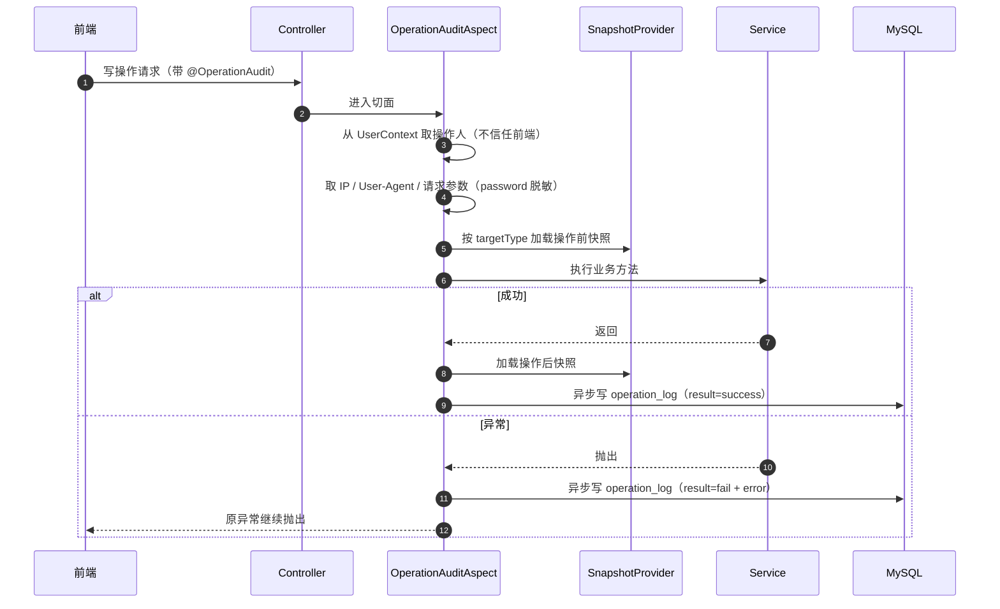

- 覆盖所有对外写操作：工单、知识库、用户、草稿、客户、联系人、工作组。
- 登录 / 注册不走切面（此时 `UserContext` 为空），在 `UserService` 里手动记录成功与失败。
- 越权访问由 `RoleInterceptor` 手动补记，`result=fail`。
- 查询类操作不记录，避免日志泛滥；GitHub 定时同步入库暂不埋点。

---

## 10. 一条工单的端到端串联

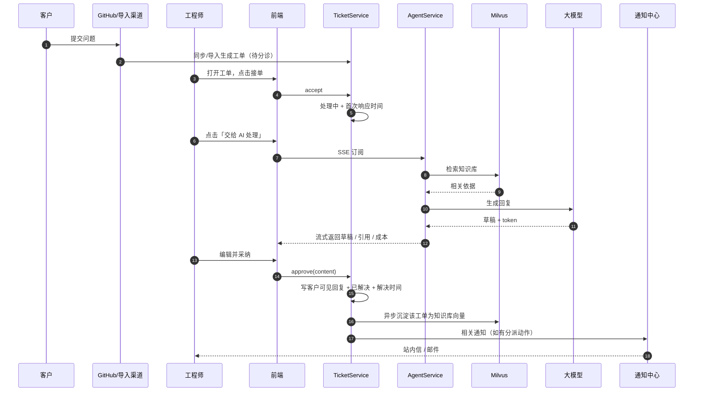

对应到数据库，一次完整流转会写入：`ticket`（状态与时间字段）、`ticket_message`（回复）、`draft`（采纳与反馈）、`agent_run`（token 与成本）、`kb_doc` + `kb_chunk`（沉淀）、`notification`（通知）、`operation_log`（审计）。

---

## 11. 核心数据模型

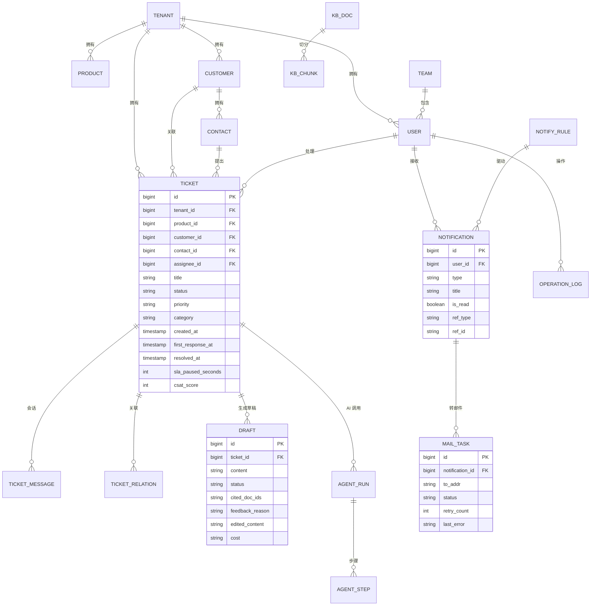

其余表：`app_user`、`team`、`reply_template`、`eval_case`、`kb_doc`、`kb_chunk`、`agent_run`、`agent_step`、`operation_log`、`ticket_relation`。
表结构统一由 `backend/src/main/resources/db/schema-mysql.sql` 管理，采用 `CREATE TABLE IF NOT EXISTS` + 动态 `ALTER` 的幂等迁移，重启不报错。

---

## 12. 已知限制与设计取舍

1. **审批流未实现**：`APPROVAL_TODO / APPROVAL_RESULT` 只有事件类型与规则位，事件源在 V2.1。
2. **SLA 预警 / 超时未接定时扫描**：规则可配，但当前没有扫描任务产生事件（V2.1）。
3. **手工客户回复不自动重开**：自动重开只在 GitHub 同步链路生效。
4. **「仅看超时」未扣暂停**：SQL 谓词粗判，展示层精确。
5. **邮件收件人是推导地址**：`username@MAIL_DOMAIN`，没有独立邮箱字段。
6. **演示模式放宽数据权限**：无 JWT（`tenant_id=null`）时数据范围为 `ALL`，生产多租户依赖 JWT。
7. **GitHub 同步不入审计**：同步不走 Controller，未埋点。
8. **AI 回退是兜底而非默认**：`app.ai.mock-enabled` 写死 false，只有真实调用失败才回退演示时间线。

---

## 13. 代码索引

| 业务流程 | 关键实现 |
| --- | --- |
| 登录 / 鉴权 | [AuthController](../backend/src/main/java/com/supportpilot/controller/AuthController.java)、[AuthFilter](../backend/src/main/java/com/supportpilot/config/AuthFilter.java)、[JwtUtil](../backend/src/main/java/com/supportpilot/common/JwtUtil.java) |
| 角色与数据权限 | [Role](../backend/src/main/java/com/supportpilot/common/Role.java)、[RequireRole](../backend/src/main/java/com/supportpilot/common/security/RequireRole.java)、[RoleInterceptor](../backend/src/main/java/com/supportpilot/config/RoleInterceptor.java)、[UserContext](../backend/src/main/java/com/supportpilot/common/UserContext.java) |
| 工单主流程 | [TicketController](../backend/src/main/java/com/supportpilot/controller/TicketController.java)、[TicketService](../backend/src/main/java/com/supportpilot/service/TicketService.java) |
| SLA 计时 | [SlaService](../backend/src/main/java/com/supportpilot/service/SlaService.java) |
| AI 流式生成 / 分诊 | [AgentController](../backend/src/main/java/com/supportpilot/controller/AgentController.java)、[AgentService](../backend/src/main/java/com/supportpilot/service/AgentService.java) |
| 草稿采纳 / 驳回 | [DraftController](../backend/src/main/java/com/supportpilot/controller/DraftController.java)、[DraftService](../backend/src/main/java/com/supportpilot/service/DraftService.java) |
| 知识库与 RAG | [KbController](../backend/src/main/java/com/supportpilot/controller/KbController.java)、[KbService](../backend/src/main/java/com/supportpilot/service/KbService.java)、[KbIndexService](../backend/src/main/java/com/supportpilot/service/KbIndexService.java)、[RealRagService](../backend/src/main/java/com/supportpilot/rag/RealRagService.java) |
| 通知与邮件 | [NotificationDispatcher](../backend/src/main/java/com/supportpilot/service/NotificationDispatcher.java)、[NotificationService](../backend/src/main/java/com/supportpilot/service/NotificationService.java)、[NotifyRuleService](../backend/src/main/java/com/supportpilot/service/NotifyRuleService.java)、[MailService](../backend/src/main/java/com/supportpilot/service/MailService.java) |
| 客户域 | [CustomerService](../backend/src/main/java/com/supportpilot/service/CustomerService.java)、[ContactService](../backend/src/main/java/com/supportpilot/service/ContactService.java) |
| GitHub 同步 | [GitHubSyncService](../backend/src/main/java/com/supportpilot/service/GitHubSyncService.java) |
| 看板指标 | [MetricsService](../backend/src/main/java/com/supportpilot/service/MetricsService.java)、[BoardVO](../backend/src/main/java/com/supportpilot/dto/BoardVO.java) |
| 操作审计 | [OperationAudit](../backend/src/main/java/com/supportpilot/common/audit/OperationAudit.java)、[OperationAuditAspect](../backend/src/main/java/com/supportpilot/config/OperationAuditAspect.java)、[OperationLogService](../backend/src/main/java/com/supportpilot/service/OperationLogService.java) |
| 数据库结构 | [schema-mysql.sql](../backend/src/main/resources/db/schema-mysql.sql) |
| 前端页面与路由 | [App.tsx](../frontend/src/App.tsx)、[Shell.tsx](../frontend/src/layouts/Shell.tsx)、[client.ts](../frontend/src/api/client.ts) |
| 历史改动记录 | [改动清单.md](./改动清单.md) |
